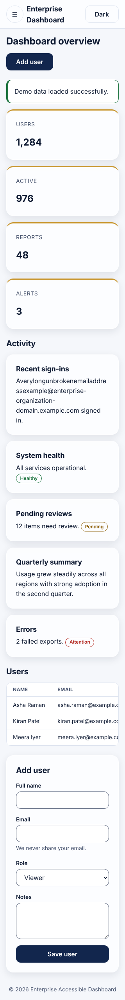
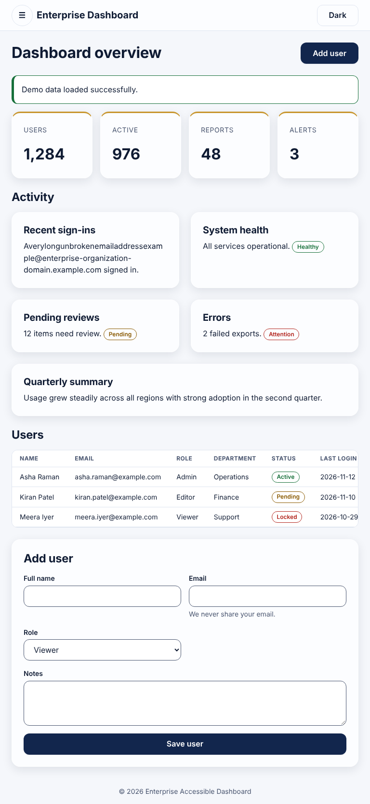
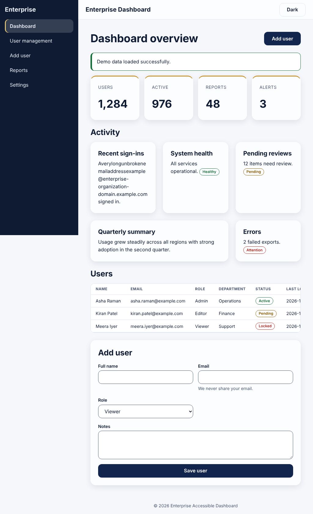
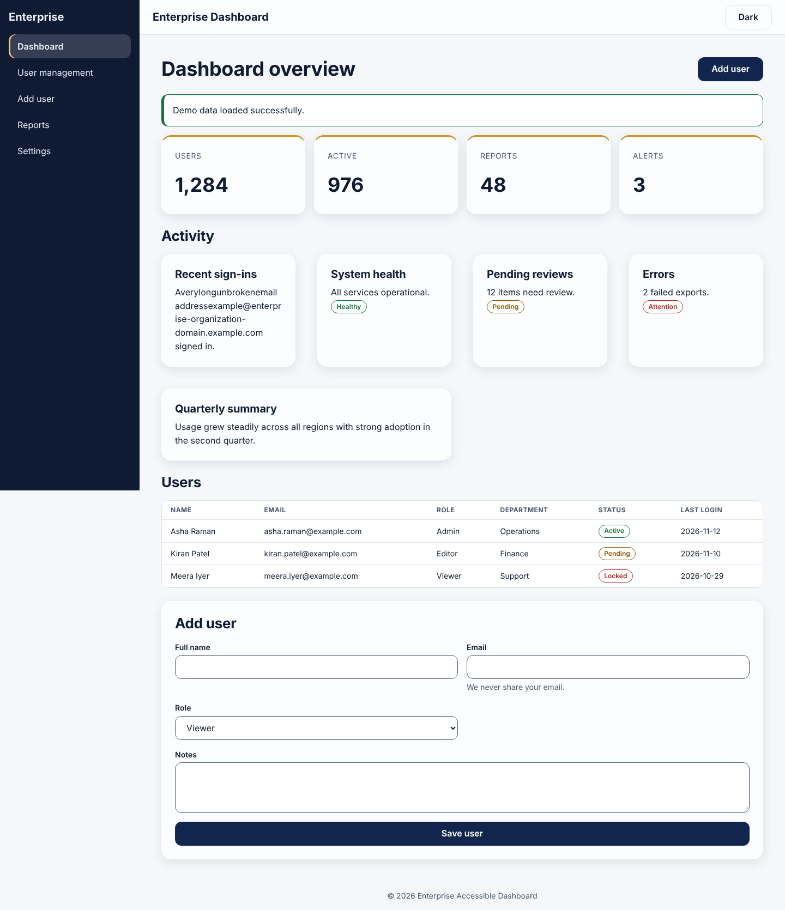
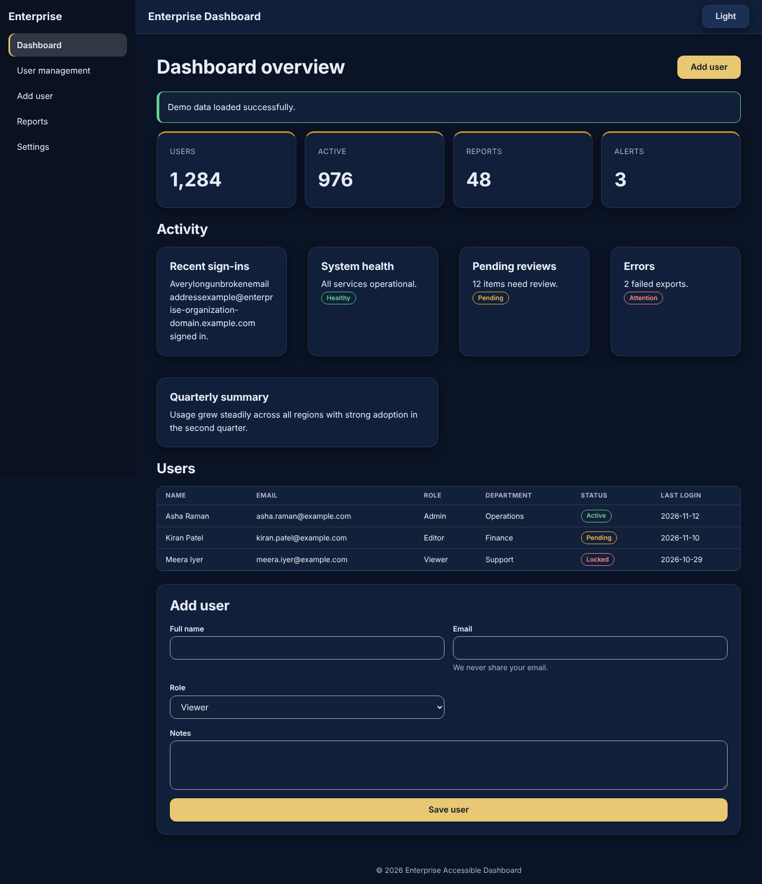

# Task 04 – Responsive Design Tokens & Mobile-First CSS

Drop-in CSS architecture for the Enterprise Accessible Dashboard.

## Contents
- `css/` — tokens, reset, base, layout, components, responsive, themes, accessibility
- `js/` — `theme.js` (theme toggle + localStorage), `nav.js` (collapsible sidebar), `modal.js` (dialogs)
- `demo.html` — sample dashboard page that uses everything
- `docs/responsive-design.md` — architecture notes
- `docs/test-responsive.py` — Playwright script that produced the results and screenshots below
- `docs/screenshots/` — real screenshots from the demo page

## Setup
Open `demo.html` in a browser. To use in your own pages, add the 8 stylesheet links (in the order above) and the 3 scripts exactly as in `demo.html`, then use the same class names (or rename selectors to match your markup).

## Tested results (real Chromium, `demo.html`)
| Viewport | Horizontal overflow |
|---------:|--------------------|
| 320px  | none (scrollWidth 320 = clientWidth 320) |
| 375px  | none |
| 768px  | none |
| 1024px | none |
| 1440px | none |

Also verified: theme toggle switches and persists after reload; `aria-label` updates; mobile menu opens/closes with button and Esc and moves focus in and back; modal opens, fits at 375px, closes with Esc; first Tab stop is the skip link.

## Screenshots

## Limitations
Tested only on the demo page and in Chromium. Your real dashboard pages still need the same checks. Colour contrast was designed for WCAG AA but not machine-audited.
